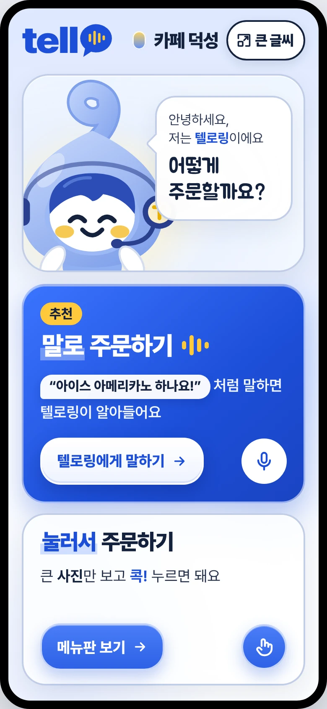
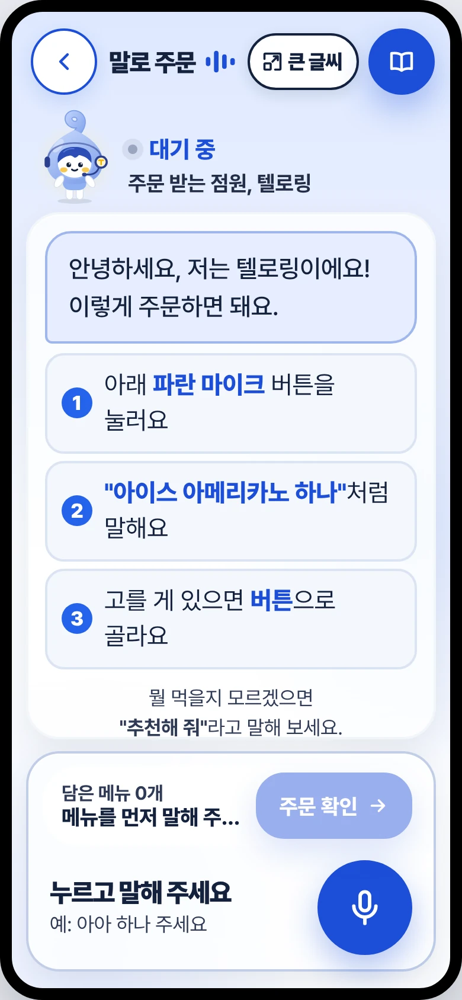
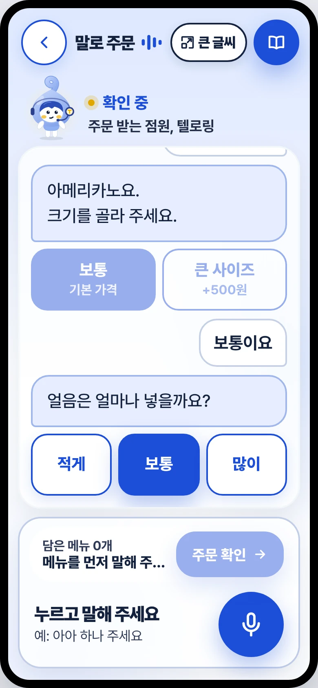
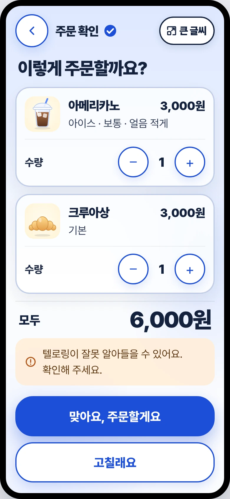
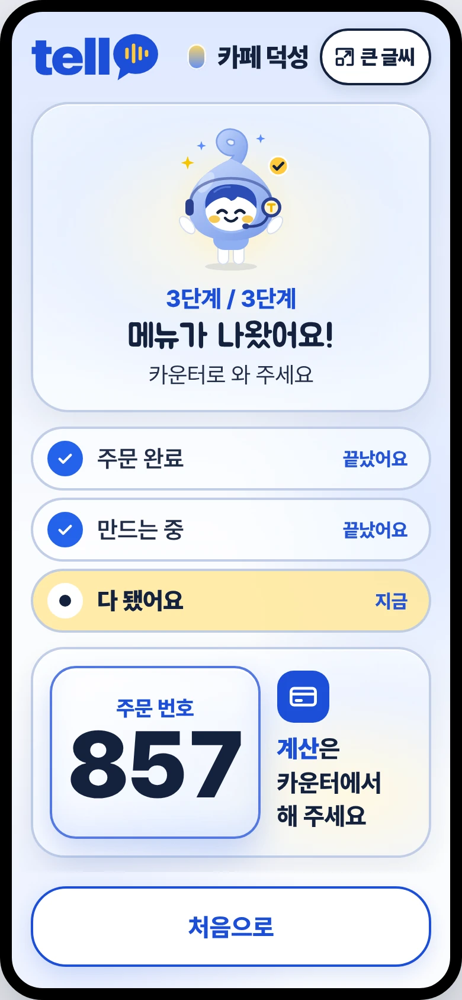
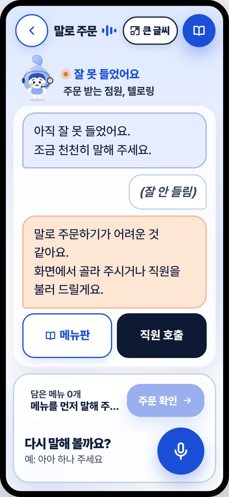
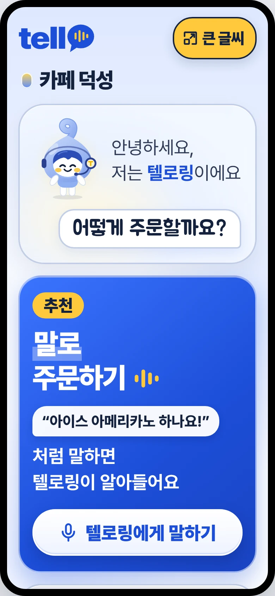
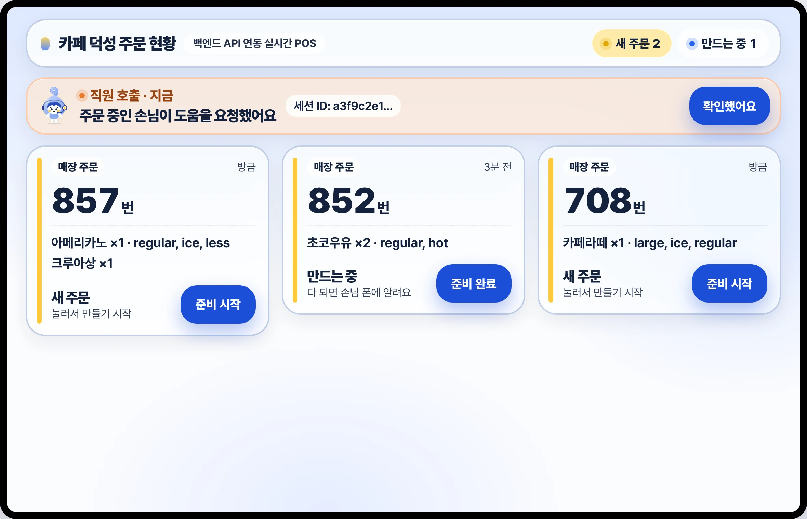

<div align="center">

# Tello 텔로
<p align="center">
  
</p>

### Hello, Tello! 👋

**장벽 없는 주문의 시작, 내 손 안의 배리어프리 키오스크**

[📹 시연 영상](#-시연-영상) · [💻 프론트엔드 레포](https://github.com/omwlsoi/tello-front) · [🛠 백엔드 레포](https://github.com/yedamimi/tello-backend)

</div>

<br/>

## 🌱 프로젝트 소개

2026년 1월부터 배리어프리 키오스크 의무화가 시행되었지만, 사장님들에겐 2배 이상 비싼 기기값이 여전히 큰 부담입니다. 
게다가 기계를 바꿔도 시각장애인의 72.3%, 휠체어 이용자의 61.5%는 여전히 직원의 도움을 선호합니다. 단순히 '새로운 기계'를 놓는 것만으로는 진짜 불편함이 사라지지 않은 셈이죠.

그래서 Tello는 아예 방향을 바꿨습니다.
비싸고 낯선 기계를 새로 들이는 대신, **우리에게 가장 익숙한 '내 스마트폰'을 키오스크로 만들면 어떨까?**

매장 QR만 찍으면 내 폰이 나만의 맞춤형 키오스크로 변신합니다. 평소 쓰던 폰의 글씨 크기와 화면 읽기 기능을 그대로 쓸 수 있고, 복잡한 터치 대신 친숙한 목소리로 주문할 수 있습니다.

> 🧓 키오스크 앞이 두려운 고령층도, 👧 혼자 주문해 보고 싶은 어린이도
> 뒷사람 눈치 볼 필요 없이, 내 폰에서 **음성**으로 쉽게 주문할 수 있습니다.

| 이용자 | 사장님 | 사회 |
|---|---|---|
| 남의 도움 없이 혼자서도 편안한 주문 | 비싼 기기 교체 없이 배리어프리 의무 대응 | 형식적 설치가 아닌 진짜 '접근성' 개선 |

<br/>

## ✨ 핵심 기능

### 1. 🎙️ 대화형 음성 주문
"아아 하나, 얼음 적게"처럼 평소 말투로 말하면 AI 캐릭터 **텔로링**이 메뉴, 수량, 옵션을 찰떡같이 알아듣습니다. 
빠진 옵션은 다시 물어보고, 최종 주문 내역을 음성으로 한 번 더 읽어주어 주문 실수를 막아줍니다. 옵션은 화면을 터치해도 되고, 마이크로 대답해도 됩니다.

### 2. 📱 내 폰 = 키오스크
매장에 있는 QR코드를 찍으면 **앱 설치 없이 웹으로 바로 열립니다.** 
스마트폰에 이미 설정해 둔 글씨 크기나 접근성 기능(화면 읽기 등)을 그대로 가져와 사용할 수 있습니다.

### 3. 🔠 큰글씨 모드
상단 **큰 글씨** 버튼 하나만 누르면 화면의 글씨와 버튼들이 **1.5배** 시원하게 커집니다.

### 4. 🙋 막혔을 때만 나타나는 직원 호출
처음부터 직원 호출을 강요하지 않습니다. 에러가 나거나 진행이 막혔을 때 등, 정말 도움이 필요한 순간에만 직원 호출 버튼이 나타납니다. 
음성 주문과 터치 주문은 **같은 장바구니**를 쓰기 때문에 언제든 편한 방식으로 넘나들 수 있습니다.

### 5. 🧑‍🍳 사장님 화면
사장님 전용 페이지(`/boss`)에서 지금 들어온 주문과 직원 호출 요청을 한눈에 확인하고 빠르게 처리할 수 있습니다.

<br/>

## 📹 시연 영상

<!-- 여기에 영상 파일 드래그 -->

<br/>

## 📱 화면 미리보기

| 첫 화면 | 음성 주문 | 옵션 되묻기 | 주문 확인 | 메뉴 완성 |
|:---:|:---:|:---:|:---:|:---:|
|  |  |  |  |  |

| 🙋 막히면 직원 호출 | 🔠 큰 글씨 모드 | 🧑‍🍳 사장님 화면 |
|:---:|:---:|:---:|
|  |  |  |

<br/>

## 🔁 서비스 흐름

```
📷 매장 QR 스캔
   ↓
🌐 웹 주문 화면 실행 (앱 설치 X)
   ↓
🎙️ 음성 · 터치로 자유롭게 주문
   ↓
   ↓  음성 → STT(Web Speech API) → 룰베이스 + Gemini(메뉴·수량·옵션 파악) → TTS(음성 안내)
   ↓
✅ 텔로링이 주문 내용 읽어주기 → 이용자 최종 확인
   ↓
🧾 주문 전달 → 🧑‍🍳 사장님 화면에서 확인 및 처리
```

<br/>

## 💻 기술 스택

| 역할 | 종류 | 선정 이유 |
|---|---|---|
| Frontend |    | 컴포넌트 단위로 화면을 재사용하고, HMR을 통한 빠른 개발 환경 구축 |
| Routing |  | 진입 → 메뉴 → 음성 → 확인 → 현황 등 자연스러운 화면 흐름 제어 |
| State |  | 장바구니, 대화 기록, 큰 글씨 모드 등 전역 상태를 가볍게 관리 |
| Data Fetching |  | 공통 API 클라이언트로 백엔드 요청과 에러 처리를 한곳에서 중앙화 |
| Voice | Web Speech API | 별도 플러그인 설치 없이 브라우저 기본 기능으로 빠르고 가벼운 STT/TTS 구현 |
| Backend |   | AI 연동이 쉽고 비동기 처리에 강한 Python 기반으로 가볍고 빠른 REST API 구성 |
| Database |  | Realtime Database로 매장·메뉴·장바구니·주문 데이터를 저장하고, Auth로 사장님 로그인 간편 처리 |
| AI |  | 정해진 패턴은 룰베이스로 빠르게 거르고, 자유로운 발화는 Gemini로 자연스럽게 분석 |
| Formatting |   | 코드 스타일을 통일해 협업 시 포맷팅 충돌 방지 |
| 협업 |    | 이슈·PR 관리, API 명세 및 연동 체크리스트 공유, UI 와이어프레임 설계 |

<br/>

## 👩‍💻 팀원 소개

<!-- TODO: PM·백엔드 팀원 깃허브 아이디와 이름, 담당 확인해서 채우기 -->
|  |  |  |  |  |
|:---:|:---:|:---:|:---:|:---:|
| [이름](https://github.com/PM아이디) | [이름](https://github.com/omwlsoi) | [석연](https://github.com/seokyeonyy) | [예담](https://github.com/yedamimi) | [지윤](https://github.com/BE아이디) |
| PM | Frontend | Frontend | Backend | Backend |
<br/>

## 🚀 실행 방법

> 🔐 `.env` 파일과 키 값은 팀 노션에 있습니다. (절대 커밋 금지!)

### Backend

```bash
cd backend

# 1. 가상환경 생성 및 활성화
python -m venv .venv
source .venv/bin/activate   # Windows: .venv\Scripts\activate

# 2. 패키지 설치
pip install -r requirements.txt

# 3. 환경 변수 설정 (.env)
#    FIREBASE_CREDENTIALS_PATH=  Firebase 서비스 계정 키 파일 경로
#    FIREBASE_DATABASE_URL=      Firebase Realtime Database 주소
#    GEMINI_API_KEY=             Gemini API 키
#    GEMINI_MODEL=               사용할 Gemini 모델명

# 4. 시연용 메뉴 등록 (최초 1회)
python seed_menus.py

# 5. 서버 실행
uvicorn app.main:app --reload
```

### Frontend

```bash
cd frontend

# 1. 패키지 설치
npm install

# 2. 환경 변수 설정
cp .env.example .env.local
#    VITE_API_BASE_URL=/api
#    VITE_API_PROXY_TARGET=http://localhost:8000   (백엔드 주소)

# 3. 실행 → http://localhost:5173
npm run dev
```

> 🎙️ 음성 인식(STT) 기능은 Web Speech API를 사용하므로 <b>Chrome 또는 Edge</b> 브라우저 사용을 권장합니다.

<br/>

## 📂 폴더 구조

```
Tello/
├── frontend/
│   ├── public/
│   └── src/
│       ├── api/            # 백엔드 연동 클라이언트 (session, order, admin)
│       ├── assets/         # 텔로링 캐릭터, 아이콘 등 정적 리소스
│       ├── components/
│       │   ├── common/     # 버튼, 헤더, 바텀시트 등 공통 UI
│       │   └── order/      # 메뉴 카드, 장바구니 바 등 도메인 UI
│       ├── hooks/          # 커스텀 훅 (음성 처리, 대기 타이머 등)
│       ├── mocks/          # 프론트엔드 단독 테스트용 가상 데이터
│       ├── pages/          # Entry, Menu, Voice, Confirm, OrderStatus, Boss 페이지
│       ├── stores/         # Zustand 전역 상태 관리
│       ├── styles/         # 글로벌 스타일 및 테마 토큰
│       └── utils/          # 가격 포맷팅 등 유틸 함수
│
└── backend/
    ├── app/
    │   ├── api/            # API 엔드포인트 라우터
    │   ├── core/           # DB 연결 및 보안/환경 설정
    │   ├── repositories/   # Firebase 접근 등 DB 레이어
    │   ├── schemas/        # 요청/응답 Pydantic 모델
    │   ├── services/       # 비즈니스 로직 및 Gemini API 연동
    │   └── main.py         # FastAPI 앱 진입점
    ├── seed_menus.py       # 시연용 기초 메뉴 데이터 등록 스크립트
    └── requirements.txt
```

<br/>

## 🌿 협업 규칙

### 브랜치
- `main` : 언제든 배포/시연 가능한 안정적인 상태
- `feature/{domain}-{detail}` : 기능 개발 (예: `feature/order-voice`)
- `fix/` · `refactor/` : 버그 수정 및 코드 정리

### 커밋 컨벤션
`type: 작업 내용` (예: `feat: 음성 주문 확인 화면 구현`)

| 타입 | 설명 | 타입 | 설명 |
|---|---|---|---|
| `feat` | 새 기능 추가 | `design` | UI/CSS 퍼블리싱 |
| `fix` | 버그 수정 | `comment` | 주석 추가/변경 |
| `docs` | README 등 문서 수정 | `rename` | 파일/폴더명 변경 |
| `style` | 코드 포맷팅, 세미콜론 누락 등 | `remove` | 파일 삭제 |
| `refactor` | 코드 리팩토링 | `chore` | 빌드 업무, 패키지 설정 |

### PR (Pull Request)
- 제목: `[타입] #이슈번호 작업내용`
- 본문: 관련된 이슈 번호, 작업한 내용 상세, 결과 화면(스크린샷), 리뷰어가 중점적으로 볼 부분
- 체크리스트: 로컬에서 에러 없이 실행되는지, `.env`나 키 파일이 올라가지 않았는지 반드시 확인!

### 코드 스타일 가이드
- ESLint + Prettier 설정을 따릅니다. (세미콜론 O, 싱글 쿼트, 들여쓰기 4칸)
- React: 컴포넌트는 `PascalCase`, 함수/변수는 `camelCase`, 커스텀 훅은 `usePascalCase`
- Python: 파일/함수/변수는 `snake_case`, 클래스는 `PascalCase`
- 공통: 가격은 서버에서 원 단위 정수(number)로 주고받으며, 프론트 화면에 그릴 때만 `formatPrice` 유틸을 씁니다.

<br/>

<div align="center">

<b>Tello</b> — 다름을 바꾸지 않고, 연결합니다.

</div>
